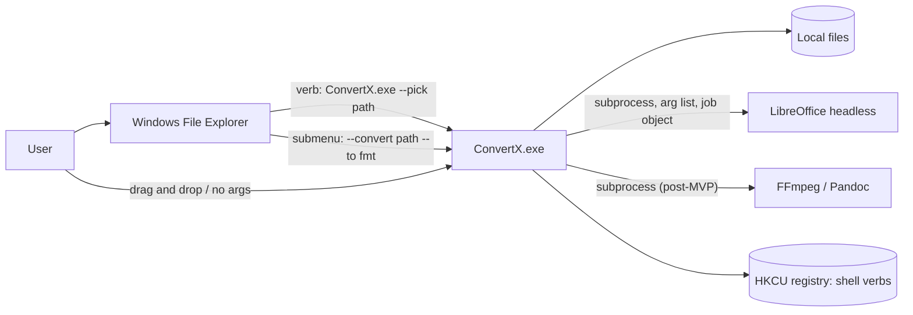
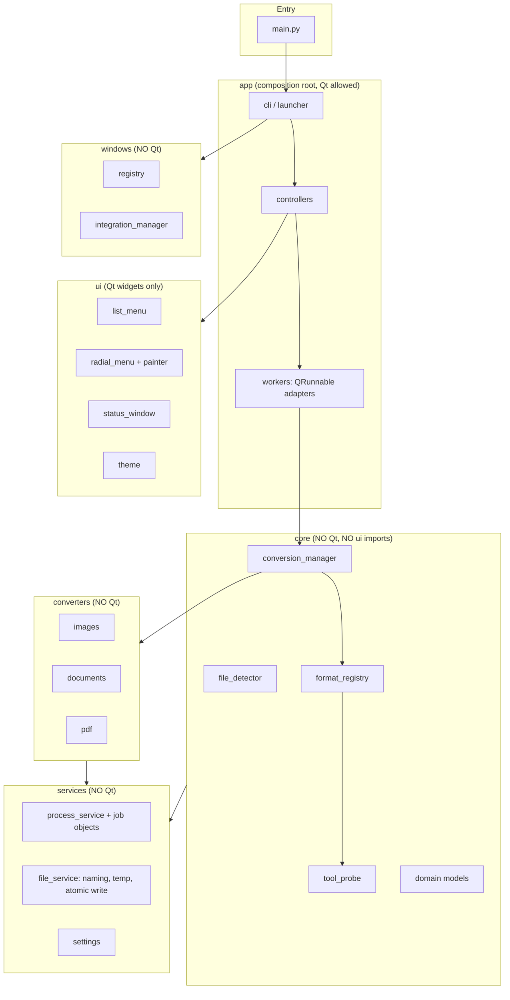
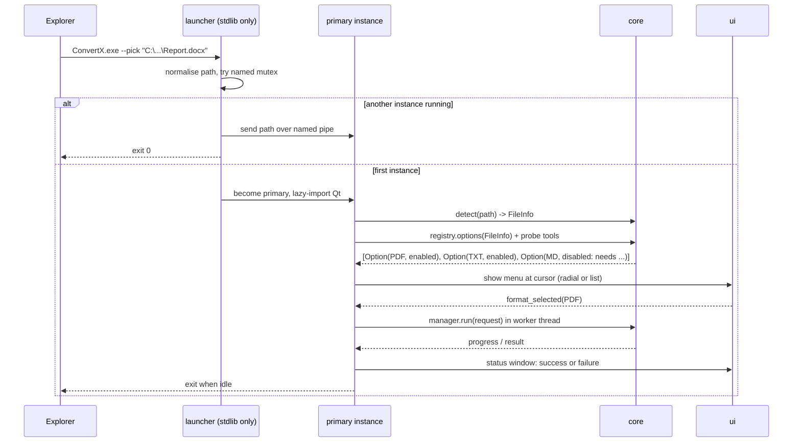

# ConvertX — Architecture

**Status:** Proposed, awaiting owner approval. No application code has been written.
**Baseline:** `Project_Descritpion.md` Revision 2. Rationale for each choice: `TECHNICAL_DECISIONS.md` (referenced as TD-nn).

---

## 1. Goals and constraints that shape the design

| Constraint | Architectural consequence |
|---|---|
| Launched from Explorer on every use | Start-up time is a first-class design input; lazy imports; no resident process in MVP |
| Arbitrary, possibly hostile user files | Every conversion is untrusted-input processing: limits, timeouts, kill-trees, no network |
| Zero cost, offline, privacy-first | No cloud code at all; external tools detected, not bundled |
| Radial UI is the signature, but unproven | UI is a replaceable front end over a stable core and CLI |
| Windows 11 hides classic verbs | Shell integration is a thin, replaceable layer that only calls the CLI |
| Solo developer with AI agents | Small modules, hard layer boundaries enforced by tooling, pure functions where possible |

---

## 2. System context



There is **no network edge**. The shell integration passes only a file path and, in direct mode, a format identifier.

---

## 3. Layering and dependency rules



### Enforceable rules (checked by `import-linter` in tests)

1. `core`, `converters`, `services`, `windows` **must not import** `PySide6`, `convertx.ui` or `convertx.app`.
2. `ui` **must not import** `converters`, `services`, `windows`. It sees only domain models and signals from `app`.
3. `converters` **must not import** `ui`, `app`, or each other.
4. `core` may import `services`, never the reverse.
5. The only module that wires everything is `app` (composition root).
6. No module imports network libraries (`socket`, `urllib`, `http`, `requests`, ...) except an explicit allow-list for the single-instance pipe. A test enforces this.

Progress and cancellation cross the Qt boundary through plain callbacks and a cancel token. `app/workers.py` adapts them to Qt signals. This is what keeps converters testable without a GUI.

---

## 4. Review of the proposed project structure and recommended changes

| Issue in the proposed layout | Recommendation |
|---|---|
| `launcher.py` and `main.py` both at root | One entry point, `main.py`. Launcher logic becomes `convertx/launcher/` (arg parsing, single-instance forward) so it can stay import-light |
| `job_manager.py` and `conversion_manager.py` overlap | Keep `conversion_manager` (selects handler, runs one job) and fold queueing into it for MVP. Add a separate job queue only when batch arrives |
| No composition root | Add `app/` (controllers, workers, wiring). The UI no longer calls managers directly |
| `core` can accidentally import Qt | Rule 1 plus `import-linter` |
| UI "communicates selected formats to the conversion manager" | UI emits a `format_selected` signal; a controller performs the call |
| `process_service` placed beside `file_service` as a vague helper | Make it the owner of Job Objects, timeouts, no-window flags, output capture |
| No tool probe | Add `core/tool_probe.py` |
| No domain model package | Add `core/models.py` (dataclasses) so everything agrees on `FileInfo`, `ConversionSpec`, `ConversionRequest`, `ConversionResult`, `ToolStatus` |
| `radial_segment.py`, `radial_painter.py`, `animations.py` split before they are needed | Start with `radial_geometry.py` (pure) and `radial_menu.py` (widget). Split further only when the file gets large |
| Tests mirror modules loosely | Add `tests/fixtures` generated by code, plus `tests/integration` and `tests/manual` (a checklist for Explorer, DPI and focus) |
| `scripts/*.ps1` own the registry logic | The installer logic lives in Python (`windows/`), behind `--install --dry-run`. The PowerShell scripts become thin wrappers or disappear. One implementation, testable |
| `resources/icons` raster icons | Prefer SVG so icons stay sharp at every DPI |
| `build/` | Also add `packaging/` (PyInstaller spec, Inno Setup script, version file) |

### Recommended layout

```text
ConvertX/
├── main.py                         # sole executable entry point
├── pyproject.toml
├── requirements.txt / requirements-dev.txt   # pinned
├── README.md
├── docs/
│   ├── ARCHITECTURE.md TECHNICAL_DECISIONS.md IMPLEMENTATION_PLAN.md
│   ├── RISK_REGISTER.md DEPENDENCIES.md REGISTRY_CHANGES.md SPIKE_REPORT.md
├── packaging/                      # pyinstaller.spec, installer.iss, version info
├── src/convertx/
│   ├── launcher/                   # arg parse, single-instance forward (import-light)
│   ├── app/                        # composition root, controllers, Qt workers
│   ├── core/
│   │   ├── models.py               # FileInfo, ConversionSpec, Request, Result, ToolStatus
│   │   ├── file_detector.py
│   │   ├── format_registry.py
│   │   ├── tool_probe.py
│   │   ├── conversion_manager.py
│   │   └── errors.py               # error taxonomy
│   ├── converters/
│   │   ├── base.py                 # Converter protocol, ToolRequirement
│   │   ├── images.py  documents.py  pdf.py   (audio.py video.py later)
│   ├── services/
│   │   ├── process_service.py      # subprocess + Job Object + timeouts
│   │   ├── file_service.py         # naming, temp dirs, atomic no-overwrite write
│   │   ├── settings_service.py
│   │   └── logging_setup.py
│   ├── windows/
│   │   ├── registry.py             # winreg wrapper with injectable root
│   │   ├── integration_manager.py  # plan, dry run, install, uninstall, manifest
│   │   └── foreground.py           # ctypes focus helpers
│   ├── ui/
│   │   ├── list_menu.py            # built first
│   │   ├── radial_geometry.py      # PURE, no Qt
│   │   ├── radial_menu.py          # widget: paint, input, animation
│   │   ├── status_window.py
│   │   ├── drop_window.py
│   │   └── theme.py
│   └── resources/icons/*.svg
├── tests/
│   ├── unit/  integration/  manual/CHECKLIST.md
│   └── fixtures/                   # generated by code, tiny
└── scripts/                        # dev helpers only (bench, make fixtures)
```

---

## 5. Runtime flows

### 5.1 Pick flow (MVP)



### 5.2 Direct flow (cascading submenu, scripts)

`ConvertX.exe --convert <path> --to pdf` runs detection, re-probes tools, runs the job, shows the status window, and exits. It never shows a menu. A missing tool produces a clear error, because a static submenu cannot reflect availability at render time.

### 5.3 Exit codes

| Code | Meaning |
|---|---|
| 0 | Success (or request forwarded to an existing instance) |
| 2 | Bad arguments |
| 3 | Input rejected (missing, unreadable, unsupported, placeholder) |
| 4 | Required tool missing or broken |
| 5 | Conversion failed |
| 6 | Cancelled by user |

---

## 6. Radial menu specification

### 6.1 Coordinates and segments

Work in **screen coordinates** (x right, y down), logical (device-independent) pixels, origin at the menu centre.

For `N` options, `span = 360 / N` degrees. Segment `i` is **centred** at screen angle `a_i = -90 + i * span`, so segment 0 is at 12 o'clock and the order runs clockwise. Segment `i` covers `[a_i - span/2, a_i + span/2]`. A visual `gap` of 1–3 degrees is subtracted when drawing (not when hit-testing).

### 6.2 Hit testing (pure function)

```
hit_test(dx, dy, inner_r, outer_r, N, tolerance) -> index | None
  r = hypot(dx, dy)
  if r < inner_r or r > outer_r + tolerance: return None     # dead zone / outside
  theta = degrees(atan2(dy, dx))                             # clockwise-positive on screen
  shifted = (theta + 90 + span/2) mod 360                    # rotate so segment 0 starts at 0
  return floor(shifted / span)
```

Test boundaries exhaustively: exactly on segment edges, `N = 1` (a ring), `N = 2`, `N = 8`, the dead zone, and points just outside `outer_r`. Disabled segments are returned by `hit_test` but not activated; the widget decides.

### 6.3 Drawing

Each segment is a `QPainterPath`: `arcTo` along the outer radius, `lineTo` to the inner radius, `arcTo` back along the inner radius, `closeSubpath`. **Qt's angle convention is counter-clockwise from 3 o'clock**, so convert with `qt_angle = -screen_angle`. Labels and icons sit at the mid-radius along the segment's centre angle. Paint a soft shadow yourself (a radial gradient) rather than using `QGraphicsDropShadowEffect`, which behaves poorly on translucent windows. Do not use backdrop blur (rectangular only).

### 6.4 Sizing and limits

| Item | Value (initial, tune by testing) |
|---|---|
| Outer radius | 150 logical px |
| Inner radius (dead zone) | 56 px |
| Window | `2 * (outer + shadow margin)` square, **not** full screen |
| Max segments | 8. Above that: list mode, or a "More…" segment |
| Min touch target | Keep segment arc length at mid-radius above roughly 60 px |

### 6.5 Positioning

1. `pos = QCursor.pos()`.
2. `screen = QGuiApplication.screenAt(pos)` or the primary screen.
3. `avail = screen.availableGeometry()` (excludes the taskbar).
4. Clamp the **centre** so the whole circle fits: `cx = clamp(pos.x, avail.left + half, avail.right - half)`, same for `y`.
5. Set the window's screen, move, then show.
6. If the window cannot fit (tiny work area), use list mode.

**Known limits.** A classic verb receives no click coordinates, so the cursor at launch is only an approximation, and it is wrong when the menu was opened by keyboard. Positioning relative to Explorer's own menu is out of scope (it would require hooking Explorer, which is prohibited).

### 6.6 Input and accessibility

- Mouse tracking on; hover index updates only when it changes (repaint on change).
- Keyboard: arrow keys select the nearest segment in that direction, number keys 1–8 select directly, Enter confirms, Escape closes, Tab cycles.
- `QEvent.WindowDeactivate` closes the menu (click-outside).
- Expose a custom accessible interface where Qt allows, but **list mode is the accessibility guarantee**.
- Disabled segments show a reason on hover and keyboard focus.

### 6.7 Animation

120–160 ms ease-out, opacity 0 → 1 and scale about 0.9 → 1.0 on open, shorter on close. A single driving value. No geometry animation. Input is live from the first frame.

---

## 7. Domain model (core/models.py)

```text
FileInfo        path, display_name, extension, detected_format, category, size_bytes,
                flags {placeholder, readonly, long_path, signature_mismatch}

ToolRequirement name ("libreoffice"|"pandoc"|"ffmpeg"|...), min_version?

ToolStatus      name, state {available|missing|broken}, path, version, message

ConversionSpec  input_format, output_format, converter_id, lossy: bool,
                requires: [ToolRequirement], notes: str, display_name, icon_id

Option          spec, enabled: bool, disabled_reason: str | None   # what the menu renders

ConversionRequest  input_path, spec, options: dict, output_dir

ConversionResult   status {success|failed|cancelled}, output_path?, warnings[],
                   error: ConvertError?, duration, log_ref?

ConvertError    code (taxonomy below), user_message, technical_detail
```

`FileInfo` and `Option` are the only things the UI ever receives.

---

## 8. Converter plugin contract

```text
class Converter(Protocol):
    id: str
    def specs(self) -> list[ConversionSpec]: ...
    def convert(self, req: ConversionRequest, ctx: ConversionContext) -> ConversionResult: ...

ConversionContext: temp_dir, tools: dict[str, ToolStatus], progress(pct, msg),
                   cancel_token, settings, logger, process_service
```

Rules for every converter:
- Declares what it can do (`specs`) and what it needs (`requires`). It never inspects the UI or Qt.
- Writes only into `ctx.temp_dir`. The manager publishes the final file (no-overwrite, atomic).
- Checks the cancel token at safe points and reports progress as a number plus a message.
- Maps tool and library exceptions to the error taxonomy.
- Is covered by unit tests using generated fixtures, plus one integration test that opens the output.

`format_registry` is built by importing converters and collecting `specs()`. It answers `options_for(FileInfo, tool_statuses) -> list[Option]`. The Explorer registration scripts read the same registry to decide which extensions to register.

Future: third-party converters through Python entry points, loaded only if the user opts in. Out of scope for MVP.

---

## 9. Tool probe

- Looks up each tool in this order: user-configured path, bundled path (future), known install locations and registry keys, `PATH`.
- Returns `available` when the file exists and its version can be read cheaply (for LibreOffice, from the install's version metadata, not by launching it).
- Returns `broken` only after a real failure at conversion time or an explicit `--probe --deep`.
- Cached for the lifetime of the process; the whole probe must fit in a small fraction of the start-up budget.
- Output feeds `Option.enabled` and `disabled_reason`, for example `"Requires LibreOffice. Not found. Install it or set its path in settings."`

---

## 10. Execution model and threading

- **UI thread:** menu and status window only.
- **Worker:** one `QRunnable` per job via `QThreadPool` (max 1 LibreOffice job at a time; images may parallelise later). The worker calls `conversion_manager.run()` which is Qt-free.
- **External tools:** launched through `process_service`, always as an argument list, always with `CREATE_NO_WINDOW`, always inside a **Job Object** (`KILL_ON_JOB_CLOSE`) so cancel, timeout or crash terminates the whole process tree.
- **Timeouts:** per converter default (documents 120 s) with a user-visible cancel.
- **Cancellation:** a cooperative token for in-process work, kill-job for subprocesses.
- **Temp files:** one directory per job under `%LOCALAPPDATA%\ConvertX\tmp\<job-id>`, removed in a `finally` block on success, failure and cancel. A start-up sweep deletes stale job directories older than a day.
- **Publishing the result:** copy to a hidden temp name in the output directory, then `os.rename` to the final name in a collision loop (`name (1).ext`, ...). `os.rename` fails if the destination exists on Windows, which gives an atomic no-overwrite create.

---

## 11. Windows integration module

- `registry.py` wraps `winreg` behind an injectable root, so tests target a disposable subtree and never the real file associations.
- `integration_manager.py` produces an **install plan** (list of keys and values) from the format registry. It supports:
  - `--install --dry-run`: print the plan, change nothing.
  - `--install`: write the plan, then save `install-manifest.json`.
  - `--uninstall`: remove only manifest entries whose values still point to this installation.
- Keys written (MVP): `HKCU\Software\Classes\SystemFileAssociations\.<ext>\shell\ConvertX` with `MUIVerb`, `Icon`, `MultiSelectModel=Single`, and `command` = quoted exe path plus `--pick "%1"`.
- Never writes `HKLM`, never touches ProgIDs or default apps, never runs elevated.
- Every key is documented in `docs/REGISTRY_CHANGES.md` and produced from code, so the doc cannot drift.
- Cascading mode and the future native shim are additional plan generators behind the same interface.

---

## 12. Error taxonomy and user messages

| Code | When | Message style |
|---|---|---|
| `INPUT_MISSING` / `INPUT_UNREADABLE` | File gone, locked, access denied | "ConvertX can't open this file. It may be in use or protected." |
| `INPUT_UNSUPPORTED` | Format not in registry | "ConvertX doesn't support converting this file type yet." |
| `INPUT_CORRUPT` | Decoder failure | "This file looks damaged and couldn't be read." |
| `INPUT_ENCRYPTED` | Password-protected | "This file is password-protected. Remove the password and try again." |
| `INPUT_CLOUD_ONLY` | Placeholder not downloaded | "This file is online-only. Make it available offline first." |
| `LIMIT_EXCEEDED` | Pixel, size or zip-ratio cap | "This file is larger than ConvertX will safely process." |
| `TOOL_MISSING` / `TOOL_BROKEN` | Required engine absent or failing | "Converting this needs LibreOffice, which wasn't found." |
| `TIMEOUT` | Job exceeded its limit | "The conversion took too long and was stopped." |
| `OUTPUT_NOT_WRITABLE` | Read-only or unavailable folder | "ConvertX can't save next to the original file." |
| `CANCELLED` | User cancelled | "Conversion cancelled. Nothing was saved." |
| `INTERNAL` | Unexpected | "Something went wrong. Copy details to report it." |

Technical detail (exit codes, stderr, stack traces) goes to the log and the "Copy details" action, never the headline message.

---

## 12b. Threat model (summary)

| Threat | Control |
|---|---|
| Crafted image (decompression bomb, malformed decoder input) | Pixel cap, size cap, short-lived process, error handling; worker-process isolation as later hardening |
| Crafted Office file (zip bomb, macros, external links) | Zip-ratio pre-check, macro level locked down, link updates disabled, timeout, Job Object; residual network-fetch risk documented |
| Path tricks (device names, UNC, traversal, trailing dots/spaces) | Normalise and validate; reject device paths and directories; output always derived from the input's folder and a sanitised name |
| Command injection | Argument lists only; no `shell=True`; no user text in command strings beyond validated paths |
| Orphaned or runaway processes | Job Objects, timeouts, cancel |
| Overwriting or corrupting originals | Originals opened read-only, never written; no-overwrite atomic publish |
| Registry damage | Per-user, manifest-driven, dry-run first, injectable root in tests |
| Privacy leaks | No network code, no telemetry, log hygiene |
| Supply chain | Pinned dependencies, hash-checked installs, public CI builds, license review |

---

## 13. Storage layout

| Path | Contents |
|---|---|
| `%LOCALAPPDATA%\Programs\ConvertX\` | Application (onedir) |
| `%APPDATA%\ConvertX\settings.json` | User settings |
| `%LOCALAPPDATA%\ConvertX\install-manifest.json` | Registry entries written |
| `%LOCALAPPDATA%\ConvertX\logs\` | Rotating logs |
| `%LOCALAPPDATA%\ConvertX\tmp\` | Per-job temp directories |
| `%LOCALAPPDATA%\ConvertX\lo-profile\` | ConvertX-owned LibreOffice profile |

---

## 14. Extension points (designed for, not built)

- New converters: one module plus tests; the registry and Explorer registration update automatically.
- New front ends: any UI that consumes `FileInfo`, `Option` and emits a chosen `ConversionSpec`.
- New integration modes: another plan generator in `windows/` (cascading submenu, modern-menu sparse package).
- Batch and multi-file: the single-instance channel already carries paths; add a queue in `conversion_manager`.
- Presets and settings: converter `options_schema` drives a generic options UI later.
